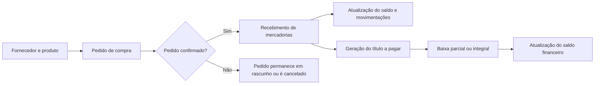
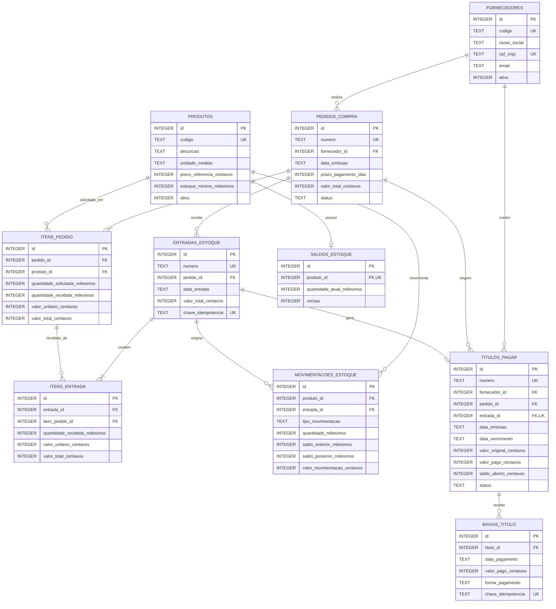

# MiniERP Backoffice

**Sistema de Compras, Estoque e Contas a Pagar | API REST em Java e Spring Boot**

## Sobre o projeto

MiniERP Backoffice é uma aplicação acadêmica que simula o ciclo de Compras, Estoque e Contas a Pagar de um ERP. Implementa cadastro de fornecedores e produtos, pedidos de compra, recebimento de mercadorias com atualização de saldo, geração de títulos a pagar e registro de pagamentos.

O projeto explora regras de negócio de backoffice, arquitetura em camadas, persistência relacional, APIs REST e testes automatizados. Os processos são inspirados em rotinas comuns de ERP; não há integração com o TOTVS Protheus.

## Tecnologias utilizadas

| Tecnologia | Versão verificada | Finalidade |
|---|---:|---|
| Java | 21 | Linguagem e versão de compilação |
| Spring Boot | 3.4.5 | Aplicação web, API REST e configuração |
| Spring Data JPA / Hibernate | Gerenciada pelo Spring Boot | Mapeamento objeto-relacional e persistência |
| SQLite | JDBC 3.49.1.0 | Banco relacional embarcado, em arquivo |
| Hibernate Community Dialects | Gerenciada pelo Spring Boot | Dialeto SQLite |
| Jakarta Bean Validation | Gerenciada pelo Spring Boot | Validação dos DTOs de entrada |
| JUnit 5, Mockito, Spring Boot Test | Gerenciados pelo Spring Boot | Testes unitários e de integração |
| Maven | Wrapper 3.9.9 | Dependências, compilação e testes |
| HTML, CSS e JavaScript | JavaScript puro | Interface estática servida pela aplicação |

O esquema é aplicado pelo `SqliteMigrationRunner`, a partir de scripts SQL versionados em `src/main/resources/db/migration`, e registrado em `schema_version`. Flyway, PostgreSQL, Docker e Docker Compose não fazem parte da implementação atual.

## Funcionalidades

### Compras

- Cadastro, edição, busca e inativação/reativação de fornecedores e produtos.
- Criação de pedidos com vários itens, cálculo do total e controle de status.
- Confirmação e cancelamento conforme as regras de transição.
- Consulta de itens pendentes e entradas associadas ao pedido.

### Estoque

- Recebimento parcial ou integral de pedidos confirmados.
- Atualização de saldo e registro de movimentações no recebimento.
- Consulta de saldo, histórico e produtos abaixo do estoque mínimo.
- Chave de idempotência para impedir duplicação do recebimento.

### Financeiro

- Geração de um título a pagar por entrada recebida.
- Cálculo do vencimento com base no prazo de pagamento do pedido.
- Registro de pagamentos parciais ou integrais e consulta do histórico.
- Filtros de títulos por fornecedor, status, vencimento e período.
- Relatório financeiro e resumo do sistema.

## Regras de negócio implementadas

1. **Validação cadastral:** campos obrigatórios e formatos são validados nos DTOs; CPF/CNPJ, códigos e unicidade também são verificados pelas regras de cadastro e/ou constraints do banco.
2. **Pedido de compra:** exige fornecedor ativo e pelo menos um item. Os produtos devem existir e estar ativos; quantidade e preço unitário devem ser positivos. Um produto não pode aparecer duas vezes no mesmo pedido.
3. **Cálculo:** cada subtotal é calculado como quantidade × preço unitário e arredondado para centavos com `HALF_UP`; o total é a soma dos subtotais.
4. **Recebimento:** somente pedido confirmado e elegível pode ser recebido. A quantidade recebida não pode exceder o saldo pendente. São aceitos recebimentos parciais.
5. **Estoque:** cada recebimento confirmado incrementa o saldo e cria movimentações correspondentes. O estoque inicial não é alterado por pedido nem por cadastro de produto.
6. **Financeiro:** cada entrada gera um título no valor daquela entrada; seu vencimento é a data de entrada acrescida do prazo de pagamento do pedido.
7. **Pagamentos:** uma baixa deve ter valor positivo, não pode superar o saldo aberto e não pode ser registrada em título quitado. O saldo e o status são atualizados a cada baixa.
8. **Idempotência e consistência:** recebimentos e baixas aceitam uma chave de idempotência única. Operações de escrita são transacionais, de modo que a gravação de negócio não fique parcialmente aplicada quando uma operação falha.

### Exemplo numérico

Um item com quantidade **1,500** e preço unitário **R$ 2,35** resulta em **R$ 3,53** após arredondamento comercial do subtotal de R$ 3,525. Para um pedido de 10 unidades a R$ 25,00, um recebimento de 4 unidades aumenta o estoque em 4 e gera título de **R$ 100,00**. Com prazo de 30 dias, o vencimento será 30 dias após a data da entrada. Uma baixa de R$ 40,00 deixa saldo aberto de **R$ 60,00**; outra baixa de R$ 60,00 quita o título.

## Fluxo principal

Cadastro de fornecedor e produto → pedido em rascunho → confirmação → recebimento parcial ou integral → atualização do estoque → geração de título a pagar → registro de pagamento → atualização do saldo financeiro.



## Arquitetura

- **Controller:** expõe os endpoints REST, recebe DTOs e aciona validação HTTP.
- **Service:** aplica regras de negócio, coordena os módulos e delimita transações.
- **Repository:** utiliza Spring Data JPA para consultas e persistência.
- **Entity:** representa os dados relacionais do domínio; entidades não são a resposta direta da API.
- **DTO / Mapper:** define os contratos REST e converte dados entre DTOs e entidades.
- **Banco de dados:** SQLite com chaves estrangeiras, constraints, índices e scripts SQL versionados.
- **Frontend:** páginas em `src/main/resources/static`, servidas pelo mesmo Spring Boot e integradas à API com Fetch API.

### Estrutura do projeto

```text
src/main/java/br/com/gestao/
├── config/          # Configuração web e migrações SQLite
├── controller/      # Endpoints REST
├── dto/             # Contratos request/response
├── entity/          # Entidades JPA
├── enums/           # Status e tipos do domínio
├── exception/       # Exceções e tratamento global
├── mapper/          # Conversão de entidades e DTOs
├── repository/      # Persistência e consultas
├── service/         # Regras de negócio e transações
└── util/            # Validação, dinheiro, documentos e lock SQLite
src/main/resources/
├── db/migration/    # Scripts SQL versionados
└── static/          # HTML, CSS e JavaScript
src/test/java/       # Testes unitários e de integração
docs/                # Requisitos, regras, endpoints e diagramas
data/                # Banco SQLite local (não versionado)
```

## Modelo de dados

O diagrama representa as tabelas e chaves estrangeiras definidas nas migrações SQL. `ItemPedido` registra a quantidade pedida e recebida; cada `ItemEntrada` vincula uma entrada ao item original. O banco também impõe unicidade por produto em cada pedido e por item de pedido em cada entrada. O título referencia uma entrada de forma única, preservando a rastreabilidade financeira. O saldo atual é mantido separadamente do histórico de movimentações.

Arquivo completo: [docs/diagramas/modelo-entidade-relacionamento.mmd](docs/diagramas/modelo-entidade-relacionamento.mmd).



## API REST

Base local: `http://localhost:8080/api`. Os endpoints, filtros, campos dos DTOs, exemplos e erros estão descritos em [docs/endpoints.md](docs/endpoints.md). As respostas de sucesso usam JSON; rotas de criação retornam HTTP 201 e as operações de inativação de produto retornam HTTP 204.

| Módulo | Principais rotas |
|---|---|
| Fornecedores | `/fornecedores`, `/fornecedores/{id}`, `/fornecedores/{id}/pedidos`, `/fornecedores/{id}/inativar`, `/fornecedores/{id}/reativar` |
| Produtos | `/produtos`, `/produtos/{id}`, `/produtos/{id}/inativar`, `/produtos/{id}/reativar` |
| Compras | `/pedidos`, `/pedidos/{id}`, `/pedidos/{id}/confirmar`, `/pedidos/{id}/cancelar`, `/pedidos/{id}/entradas`, `/pedidos/{id}/pendencias` |
| Estoque | `/entradas`, `/entradas/{id}`, `/estoque`, `/estoque/{produtoId}`, `/estoque/{produtoId}/movimentacoes` |
| Financeiro | `/titulos`, `/titulos/{id}`, `/titulos/{id}/baixas` |
| Relatórios | `/relatorios/estoque`, `/relatorios/contas-pagar`, `/relatorios/resumo` |

## Como executar

### Pré-requisitos

- JDK 21.
- Windows PowerShell (os comandos abaixo usam o Maven Wrapper incluído).
- Não é necessário instalar servidor SQLite: o driver é dependência do projeto.

### Executar localmente

Na raiz do projeto:

```powershell
.\mvnw.cmd clean test
.\mvnw.cmd spring-boot:run
```

Abra [http://localhost:8080](http://localhost:8080). A API fica sob `/api` e a interface estática é entregue pelo próprio Spring Boot. O banco é criado em `data/gestao.db`; os scripts pendentes são aplicados na inicialização.

Para configurar porta ou URL do SQLite, defina `GESTAO_PORT` ou `GESTAO_DB_URL` no ambiente antes de iniciar. `.env.example` documenta os nomes esperados; o Spring não carrega automaticamente um arquivo `.env`. Exemplo de configuração temporária no PowerShell:

```powershell
$env:GESTAO_PORT = "8081"
$env:GESTAO_DB_URL = "jdbc:sqlite:data/gestao-local.db?busy_timeout=10000"
.\mvnw.cmd spring-boot:run
```

Para compilar sem iniciar, use `.\mvnw.cmd clean package`. Não há configuração Docker Compose neste repositório.

## Testes

Os testes utilizam JUnit 5, Mockito e Spring Boot Test. Os testes unitários cobrem validações de cadastro/documento, valores, cálculo e status de pedidos, além de pagamentos parciais/integrais e suas rejeições; os testes de integração executam o fluxo de compra, recebimentos parcial e integral, atualização do estoque, vencimento, pagamentos e concorrência usando SQLite temporário. A última execução desta revisão de `.\mvnw.cmd test` concluiu com **18 testes, 0 falhas e 0 erros**. Para executá-los:

```powershell
.\mvnw.cmd test
```

## Aprendizados explorados

- Construção e validação de APIs REST.
- Separação de responsabilidades em arquitetura em camadas.
- Modelagem relacional e integridade referencial.
- Regras de negócio de compras, estoque e contas a pagar.
- Integração entre módulos e consistência transacional.
- Validação de entrada, idempotência e concorrência.
- Testes unitários e de integração com Maven.
- Organização de código e documentação técnica.

## Melhorias futuras

- Autenticação, autorização e controle de permissões.
- Auditoria de alterações e operações críticas.
- Relatórios e filtros com paginação server-side.
- Ampliar testes unitários de transições, validação de recebimentos e baixas.
- Conteinerização, caso passe a ser um requisito de implantação.
- Evoluir a interface e incluir fluxos de manutenção de cadastros mais completos.

## Limitações atuais

Não há autenticação, integração bancária ou fiscal, NF-e, vendas/saídas, múltiplos armazéns, parcelamento de títulos, nem integração direta com o Protheus. A aplicação é uma simulação acadêmica focada no fluxo de compras, recebimento e pagamento.

## Portfólio

Descrições para GitHub, LinkedIn e currículo estão em [docs/portfolio.md](docs/portfolio.md).
